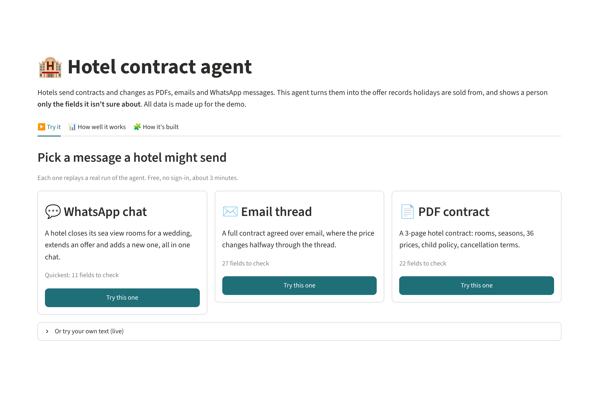

# Hotel contract-to-offer agent (learning project)

Turns messy hotel contracts (PDF, email, chat) into structured offer records with per-field confidence. All hotels, people and numbers are fictional.

The key is read from `HOTEL_AGENT_API_KEY`, falling back to `ANTHROPIC_API_KEY`.

Plan: see the "Hotel contract-to-offer agent: build plan" doc in the project.

## Layout
- `src/contract_agent/schema.py`: offer schema (Contract, ChangeSet, FieldMeta, GoldLabel)
- `src/contract_agent/offers.py`: flattens a contract into static offer rows
- `data/inputs/`: synthetic inputs (PDF, .eml, chat .txt)
- `data/gold/`: hand-labelled expected outputs
- `data/offers/gold_offers.csv`: offer rows generated from the gold contracts
- `src/contract_agent/extract.py`: one Claude call, structured output, evidence notes per field
- `src/contract_agent/intent.py`: step 4 intent detection (multi-label, Haiku, rules baseline, cascade)
- `src/contract_agent/router.py`: routes each intent to its pipeline (new contract / ARI / promotion / ignore)
- `src/contract_agent/rag.py`: step 5 retrieval: property master, contract chunks, playbook, BM25
- `src/contract_agent/tools.py`: step 6 resolver tools (room/board lookup, seasons, rates, date maths, calculator, playbook)
- `src/contract_agent/resolver.py`: step 6 ReAct resolver, its baselines, and the pipeline hook
- `data/resolver/cases.jsonl`: 28 ambiguous-field cases with expected answers (or "flag")
- `src/contract_agent/review.py`: step 7 review queue, contract versions, correction log (SQLite)
- `src/contract_agent/apply.py`: applies an approved change set to the contract as a new version
- `src/contract_agent/export.py`: offer file export (CSV / JSONL + stop sales) from approved versions only
- `src/contract_agent/orchestrate.py`: the whole flow end to end; builds the free demo replays
- `app/demo_app.py`: the review screen and demo (Streamlit)
- `data/demo/replays/`: saved runs the demo replays for free; `data/flywheel/`: logged corrections
- `data/store/`: property master (`hotels.json`) and existing contracts; `scripts/build_store.py` writes them
- `data/playbook.md`: house rules retrieved alongside the contract
- `src/contract_agent/pipeline.py`: step 3 flow: two passes, normalise, validate, check evidence, score
- `src/contract_agent/evidence.py`: checks each quote is really in the source and holds the value
- `src/contract_agent/validators.py`: deterministic business rules (seasons, cancellation, prices...)
- `src/contract_agent/confidence.py`: combined confidence score, per-field thresholds, cost weights
- `src/contract_agent/scoring.py`: field-by-field comparison against gold
- `evals/run_eval.py`: eval runner, saves results to `evals/results/` (`--rescore` re-scores an old run)
- `evals/run_intent_eval.py`: intent eval on `data/intents/messages.jsonl` (rules vs Haiku vs Opus vs cascade)
- `evals/run_retrieval_eval.py`: retrieval eval (free, no model calls): right hotel, right sections at k
- `evals/run_rag_eval.py`: chat amendment with vs without RAG, on Haiku, prints cost
- `evals/run_resolver_eval.py`: resolver eval: rules only vs one-shot vs ReAct (rules only is free)
- `evals/run_review_eval.py`: whole loop with a simulated reviewer (free): rows right before/after review
- `evals/calibration.py`: calibration chart and threshold trade-off (`evals/results/calibration.png`)
- `scripts/`: `make_pdf_contract.py` builds the PDF, `build_gold.py` writes the gold JSON
- `notes/`: concept notes for interviews

## Run
```
pip install -r requirements.txt
cp .env.example .env        # then paste your key after HOTEL_AGENT_API_KEY=
python -m pytest -q         # offline checks, no key needed
python evals/run_eval.py    # routes and extracts all inputs, scores against gold (--direct skips the router)
python evals/run_intent_eval.py --repeats 2   # intent detection eval
python evals/run_retrieval_eval.py --k 3      # retrieval eval, free
python evals/run_rag_eval.py                  # RAG on vs off, Haiku, under 1 cent
python evals/run_resolver_eval.py --llm       # resolver eval, Haiku, about 3 cents
python evals/run_review_eval.py               # review loop eval, free
python evals/calibration.py # chart from all saved step 3 runs
```

## Demo: try it in your browser



The demo opens on three one-click samples: a WhatsApp chat, an email thread and a PDF contract. Each replays a saved run of the agent through every stage:
- what kind of message it is, and which hotel
- what it looked up
- every field, with its confidence and source quote
- a short list for a person to check
- approval, and the offer file to download

It needs no sign-in, no password and no API key, and costs nothing. The **How well it works** tab has the results (see `docs/results.md`).

**On your laptop:**
```
git clone https://github.com/avi23ral/hotel-contracts-agent.git
cd hotel-contracts-agent
pip install -r requirements.txt
streamlit run app/demo_app.py
```

**As a public link (free, Streamlit Community Cloud):**
1. Go to https://share.streamlit.io and sign in with GitHub.
2. Create an app from this repo: branch `main`, main file `app/demo_app.py`, with a custom subdomain if you like.
3. Deploy. With no secrets set, the link is replay-only, which is the safe choice for emailing.

**Optional live mode**, where visitors paste their own text, adds these secrets in the app's settings:
```
HOTEL_AGENT_API_KEY = "sk-ant-..."
DEMO_PASSWORD = "pick-one"     # visitors need this to run live
DEMO_DAILY_USD = "1.0"         # soft daily cap; it resets if the app restarts
```
Also set a monthly spend limit on that API key in the Anthropic Console. That is the hard stop.

## Progress
- [x] Step 1: schema, 3 synthetic inputs, gold labels, offer rows
- [x] Step 2: baseline extractor and eval harness (first run: mean F1 0.675, intent 3/3)
- [x] Step 3: evidence checks, validators, per-field confidence and calibration (see notes/03)
- [x] Step 4: intent detection, router (ARI vs promotions), model cascade (see notes/04)
- [x] Step 5: RAG over existing contracts and the playbook, retrieval eval (see notes/05)
- [x] Step 6: ReAct resolver for ambiguous fields, with tools and a resolver eval (see notes/06)
- [x] Step 7: review screen, contract versions, offer file export, correction log, demo app (see notes/07)
- [x] Step 8: eval report and interview story (see notes/08), guided public demo
